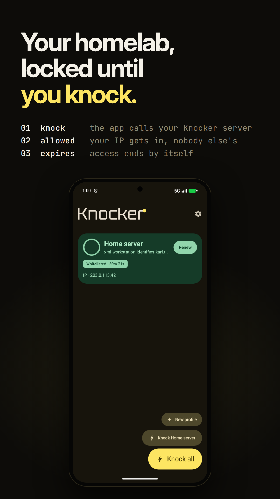
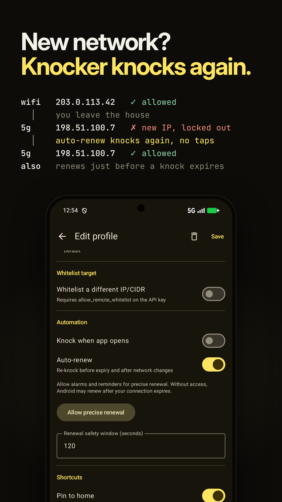
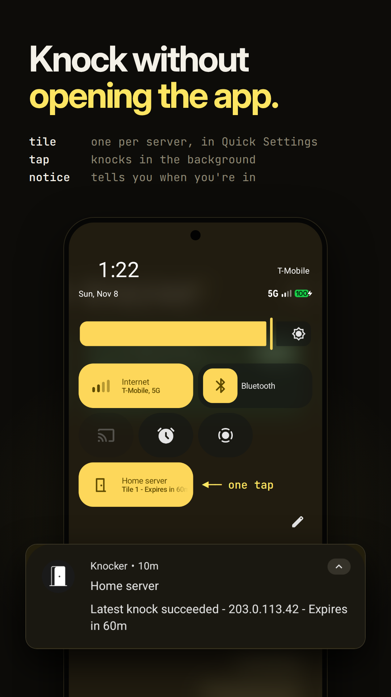
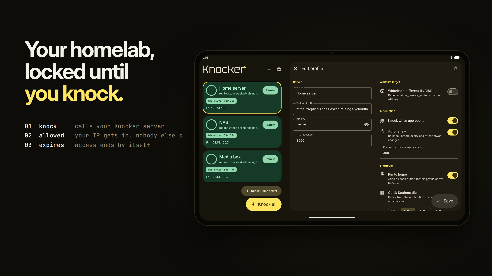
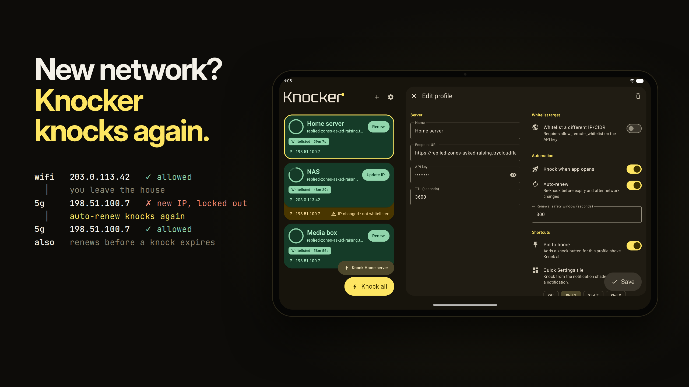
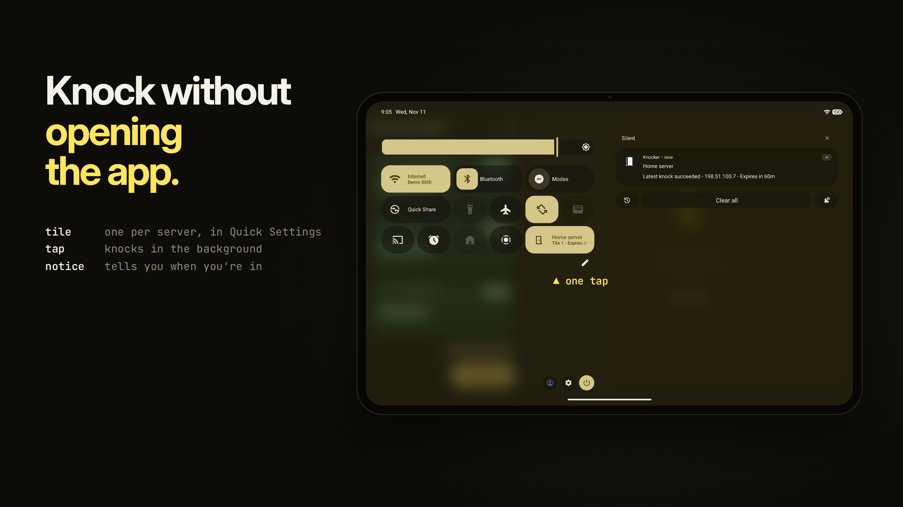

<div align="center">

<picture>
  <source media="(prefers-color-scheme: dark)" srcset="assets/images/knocker-logo-white.png">
  
</picture>

### Your homelab, locked until you knock.

The Android client for [Knocker](https://github.com/FarisZR/knocker).

<a href="https://play.google.com/store/apps/details?id=com.fariszr.knocker"></a>
&nbsp;
<a href="https://github.com/FarisZR/Knocker-app/releases"></a>

</div>

<br>

<p align="center">
  
  &nbsp;
  
  &nbsp;
  
</p>

## Features

- **Profiles for every server.** Save as many as you need, knock one with a tap, or hit **Knock all**.
- **Auto-renew.** Knocker re-knocks just before a grant expires and again after a network change, so switching from Wi-Fi to mobile data doesn't lock you out. It runs in the background, even when the app has been closed.
- **Quick Settings tiles.** Put a server in your pull-down panel and knock without opening the app. A notification reports whether it worked and when access expires.
- **Pin to home.** Give a profile its own knock button above **Knock all**.
- **Knock when the app opens**, if you'd rather it just happened.
- **Whitelist another address.** Knock for a different IP or CIDR range, when your API key allows it.
- **Looks at home on Android.** Material 3 design with light and dark themes, built for phones, tablets and foldables.

## Install

Get Knocker from [Google Play](https://play.google.com/store/apps/details?id=com.fariszr.knocker), or download the APK from the [Releases page](https://github.com/FarisZR/Knocker-app/releases), open it on your phone and allow installs from your browser or file manager when Android asks.

You'll need a running [Knocker server](https://github.com/FarisZR/knocker) to knock at. Setup and details are in its repository.

## Privacy

Knocker only talks to the servers you add. Crash reporting is on by default and can be turned off under **Settings → Crash reports**. The app opts out of Android backup and asks for no location, camera, microphone or storage access. Read the full [privacy policy](https://terms.remal.org/knocker/privacy-policy/).

<details>
<summary><strong>Tablet screenshots</strong></summary>
<br>





</details>

## Building from source

Knocker is an Expo / React Native app. The native Android screens, Quick Settings tiles and background renewal live in the local `modules/knocker-native` Expo module, so they need a native build and don't exist in Expo Go.

Use Node.js 22 and pnpm 10.28.2, from the repository root:

```sh
pnpm install --frozen-lockfile
pnpm dev          # start Expo
pnpm android      # native Android development build (needs the Android SDK)
pnpm test
pnpm typecheck
```

To package a local release APK, install Java 21 and the Android SDK, then run:

```sh
KNOCKER_ALLOW_DEBUG_SIGNING=true SENTRY_DISABLE_AUTO_UPLOAD=true pnpm android:apk
```
